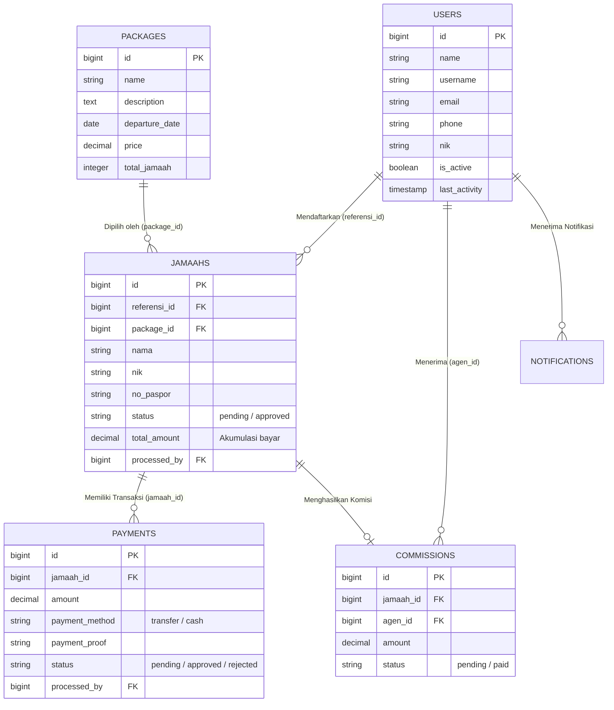

<div align="center">

  

  # ARBAIN — Umroh & Hajj Travel Management System
  
  **Platform Enterprise Terpadu untuk Manajemen Operasional Biro Perjalanan Ibadah Haji & Umroh, Jaringan Kemitraan Agen, Rekonsiliasi Finansial, dan Otomasi Komisi.**

  <p align="center">
    <a href="https://laravel.com"></a>
    <a href="https://www.php.net"></a>
    <a href="https://www.mysql.com"></a>
    <a href="https://getbootstrap.com"></a>
    <a href="https://spatie.be/open-source"></a>
  </p>

</div>

---

## 📌 Daftar Isi
- [Tentang Aplikasi](#-tentang-aplikasi)
- [Masalah & Solusi Bisnis](#-masalah--solusi-bisnis)
- [Fitur Utama Berdasarkan Peran](#-fitur-utama-berdasarkan-peran)
- [Arsitektur Sistem & Basis Data](#-arsitektur-sistem--basis-data)
- [Alur Kerja Utama (Core Workflows)](#-alur-kerja-utama-core-workflows)
- [Logika Bisnis & Otomasi Finansial](#-logika-bisnis--otomasi-finansial)
- [Panduan Instalasi & Menjalankan](#-panduan-instalasi--menjalankan)
- [Akun Percobaan (Default Seeded Credentials)](#-akun-percobaan-default-seeded-credentials)
- [Struktur Direktori](#-struktur-direktori)
- [Teknologi & Pustaka Pendukung](#-teknologi--pustaka-pendukung)

---

## 📖 Tentang Aplikasi

**Arbain** adalah sistem informasi berbasis web yang mengotomasi seluruh rantai bisnis biro travel umroh dan haji. Sistem ini menjembatani interaksi antara **Manajemen Internal (Administrator)** dan **Jaringan Mitra Pemasaran (Agen)**, mulai dari pendaftaran jamaah, verifikasi berkas paspor/KTP, rekonsiliasi pembayaran cicilan, pemantauan batas waktu pelunasan (H-60), hingga kalkulasi dan pencairan komisi agen secara transparan.

---

## 💡 Masalah & Solusi Bisnis

| Tantangan Konvensional | Solusi Sistem Arbain |
|---|---|
| **Data Jamaah Tercecer**: Pendaftaran via WhatsApp/kertas rawan hilang dan salah input berkas. | **Portal Pendaftaran Agen Mandiri**: Agen menginput data terstruktur beserta validasi NIK dan paspor. |
| **Rekonsiliasi Manual**: Bukti transfer sulit dilacak dan sering terjadi *double-counting*. | **Approval Pipeline Pembayaran**: Admin memvalidasi bukti struk/mutasi; status saldo jamaah dihitung otomatis. |
| **Jamaah Gagal Berangkat**: Keterlambatan pelunasan menjelang keberangkatan pesawat/hotel. | **Deteksi Dini H-60**: Sistem otomatis menandai jamaah berstatus *urgent* dan belum lunas menjelang keberangkatan. |
| **Sengketa Komisi Agen**: Agen tidak transparan mengetahui kapan jamaahnya lunas dan hak komisinya terbit. | **Automasi Komisi Real-time**: Komisi otomatis terbit begitu total bayar jamaah memenuhi harga paket. |

---

## 👥 Fitur Utama Berdasarkan Peran

### 1. 🛡️ Administrator (Super Management)
- **Executive Analytics Dashboard**:
  - Monitoring KPI: Total omset bersih, rasio pertumbuhan bulanan, total jamaah aktif, agen produktif, dan komisi disalurkan.
  - Grafik interaktif bulanan (Omset vs Volume Transaksi) powered by **Chart.js**.
  - Donut chart distribusi metode transaksi (Transfer Bank vs Kas Tunai).
  - Leaderboard 5 agen dengan performa pendaftaran tertinggi.
- **Verifikasi Jamaah Bertingkat**: Tinjau data identitas jamaah yang diajukan agen, berikan *Approval* atau *Rejection*.
- **Audit Pembayaran & Kas**: Review bukti transfer per transaksi sebelum dana diakumulasikan ke saldo jamaah.
- **Master Paket Umroh/Haji**: Kelola kuota kursi paket, tanggal keberangkatan, rincian fasilitas, dan harga paket.
- **Manajemen Mitra & Pengguna**: Tambah staf/agen, reset sandi, serta kontrol aktivasi/deaktivasi status akun agen.
- **Laporan & Ekspor**: Cetak rekapitulasi data jamaah, laporan komisi, dan jurnal arus kas masuk ke format Excel (.xls) dan CSV.

### 2. 🤝 Mitra Agen (Pemasaran & Jamaah)
- **Dashboard Performa Agen**: Pantau jumlah jamaah binaan, riwayat komisi yang diterima, dan grafik setoran bulanan.
- **Entri Data Jamaah**: Pendaftaran jamaah baru dengan pilihan paket perjalanan secara mandiri.
- **Pengajuan Bukti Pembayaran**: Upload bukti transfer atau pembayaran tunai jamaah ke antrean audit admin.
- **Manajemen & Invoice Jamaah**: Cetak **Invoice / Kwitansi Resmi PDF** individual untuk diserahkan ke jamaah.
- **Buku Riwayat & Komisi**: Pantau status pencairan komisi hasil pelunasan jamaah binaan serta unduh riwayat ke Excel.

---

## 🏗 Arsitektur Sistem & Basis Data

Aplikasi dibangun di atas arsitektur **Model-View-Controller (MVC)** Laravel dengan pemisahan hak akses berbasis **Role-Based Access Control (RBAC)** via Spatie.

### Entity Relationship Diagram (ERD)



---

## 🔄 Alur Kerja Utama (Core Workflows)

### 1. Alur Pendaftaran & Persetujuan Jamaah
```
[Agen] ───────────► Input Data & Pilih Paket
                          │
                          ▼
                     Status: Pending ────► [Notifikasi Masuk ke Admin]
                                                    │
                                                    ▼
                                            [Admin Review Berkas]
                                                    │
                                   ┌────────────────┴────────────────┐
                                   ▼                                 ▼
                             [DISETUJUI]                        [DITOLAK]
                       Status: Approved               Pengajuan Dihapus / Revisi
                       Agen Mendapat Notif            Agen Mendapat Notif Penolakan
```

### 2. Alur Pembayaran, Verifikasi Kas, & Komisi
```
[Agen] ───────────► Upload Bukti Transfer & Nominal
                          │
                          ▼
                     Status Pembayaran: Pending ────► [Notifikasi ke Admin]
                                                             │
                                                             ▼
                                                    [Admin Audit Mutasi]
                                                             │
                                   ┌─────────────────────────┴─────────────────────────┐
                                   ▼                                                   ▼
                             [DISETUJUI]                                           [DITOLAK]
                       total_amount Jamaah Bertambah                           Pembayaran Dibatalkan
                       Notifikasi Terkirim ke Agen
                                   │
                                   ▼
                       [Cek Evaluasi Pelunasan]
                  total_amount >= Harga Paket Terpilih?
                                   │
                    ┌──────────────┴──────────────┐
                    ▼                             ▼
                 [ YA ]                        [ TIDAK ]
            Status: LUNAS                 Status: BELUM LUNAS
       Otomatis Terbit Komisi Agen         Tercatat di Sisa Tagihan
```

---

## ⚙️ Logika Bisnis & Otomasi Finansial

Model [`Jamaah`](app/Models/Jamaah.php) dilengkapi aksesor dan scope pintar:
1. **Dynamic Settlement Check (`tagihan_status`)**:
   Status lunas dihitung dinamis dari `total_amount >= package.price`. Bebas risiko inkonsistensi status database.
2. **Early Warning H-60 (`scopeBelumLunasDiH60`)**:
   Query otomatis menyaring jamaah yang belum lunas pada 60 hari sebelum tanggal keberangkatan paket untuk prioritas follow-up.
3. **Peringatan Urgent H-90 (`urgent_status`)**:
   Tanda waspada bagi biro perjalanan untuk pengurusan visa dan tiket grup 90 hari sebelum jadwal terbang.
4. **Perhitungan Tunggakan (`sisa_pembayaran`)**:
   Dihitung dinamis: `package.price - total_amount`.

---

## 🚀 Panduan Instalasi & Menjalankan

Ikuti panduan langkah demi langkah berikut untuk menjalankan aplikasi di komputer lokal:

### 1. Prasyarat Sistem
- **PHP** >= 8.1 dengan ekstensi: `pdo_mysql`, `mbstring`, `openssl`, `gd`
- **Composer** (Dependency Manager)
- **MySQL / MariaDB** (melalui XAMPP, Laragon, atau MySQL Server standalone)

### 2. Kloning Repository
```bash
git clone https://github.com/rizkyenjoyy/arbain.git
cd arbain
```

### 3. Instal Dependensi Composer
```bash
composer install
```

### 4. Konfigurasi Environment (`.env`)
Salin file `.env.example` menjadi `.env`:
```bash
cp .env.example .env
```
Buka file `.env` dan sesuaikan koneksi database MySQL:
```env
APP_NAME=Arbain
APP_ENV=local
APP_KEY=
APP_DEBUG=true
APP_URL=http://127.0.0.1:8000

DB_CONNECTION=mysql
DB_HOST=127.0.0.1
DB_PORT=3306
DB_DATABASE=arbain
DB_USERNAME=root
DB_PASSWORD=
```

### 5. Generate Application Key
```bash
php artisan key:generate
```

### 6. Migrasi & Pengisian Data Awal (Database Seeder)
> *Pastikan Anda telah membuat database kosong bernama `arbain` di phpMyAdmin atau MySQL client Anda.*
```bash
php artisan migrate --seed
```

### 7. Buat Symbolic Link Storage
Perintah ini wajib agar foto bukti pembayaran dan berkas publik dapat diakses browser:
```bash
php artisan storage:link
```

### 8. Jalankan Server Pengembangan
```bash
php artisan serve
```
Aplikasi siap diakses melalui peramban web di: **`http://127.0.0.1:8000`**

---

## 🔑 Akun Percobaan (Default Seeded Credentials)

Setelah menjalankan `php artisan migrate --seed`, Anda dapat langsung masuk menggunakan akun pengujian:

| Peran (Role) | Username | Password | Email | Akses Halaman |
|---|---|---|---|---|
| **Administrator** | `adminuser` | `123456789` | `admin@example.com` | `http://127.0.0.1:8000/dashboard/admin` |
| **Mitra Agen** | `agenuser` | `123456789` | `agen@example.com` | `http://127.0.0.1:8000/dashboard/agen` |

---

## 📁 Struktur Direktori

```
arbain/
├── app/
│   ├── Http/Controllers/
│   │   ├── Admin/
│   │   │   └── AdminDashboardController.php  # Dashboard Eksekutif & Chart Analytics
│   │   ├── Agent/
│   │   │   └── AgentDashboardController.php  # Dashboard Kinerja Agen
│   │   ├── AdminJamaahController.php         # Verifikasi & Approval Data Jamaah
│   │   ├── AdminPaymentController.php        # Audit Bukti Pembayaran
│   │   ├── AuthController.php                # Autentikasi & Multi-role Redirection
│   │   ├── CommissionController.php          # Manajemen & Penerbitan Komisi
│   │   ├── HistoryPaymentController.php      # Riwayat Transaksi & Export PDF Invoice
│   │   ├── JamaahController.php              # Pendaftaran Jamaah oleh Agen
│   │   ├── ListJamaahController.php          # Direktori Terpadu Seluruh Jamaah
│   │   ├── PackageController.php             # Master Data Paket Haji/Umroh
│   │   ├── PaymentController.php             # Upload Transaksi & Bukti Setoran
│   │   └── UserController.php                # Manajemen User & Aktivasi Agen
│   ├── Models/
│   │   ├── Commission.php                    # Model Komisi Kemitraan
│   │   ├── Jamaah.php                        # Model Jamaah & Logika Pelunasan
│   │   ├── Package.php                       # Model Paket Perjalanan
│   │   ├── Payment.php                       # Model Transaksi Pembayaran
│   │   └── User.php                          # Model Akun Pengguna & Role
│   └── Notifications/                        # 5 Kelas Notifikasi Real-time
├── database/
│   ├── migrations/                           # 17 File Skema Database
│   └── seeders/                              # Master Seeder Data Percobaan
├── public/
│   ├── css/                                  # Styling Arbain & Bootstrap 5
│   ├── js/                                   # DataTables & Chart.js Config
│   └── img/                                  # Aset Logo Brand Arbain
├── resources/
│   └── views/
│       ├── auth/                             # Antarmuka Login
│       ├── dashboard/                        # Layout & View Dashboard Admin & Agen
│       └── laporan-keuangan/                 # Antarmuka Rekap Finansial
└── routes/
    └── web.php                               # Definisi Rute Web & Middleware RBAC
```

---

## 🛠 Teknologi & Pustaka Pendukung

- **Backend Core**: Laravel 9.x, PHP 8.1+
- **Security & Authorization**: [Spatie Laravel Permission](https://spatie.be/docs/laravel-permission) (Multi-Role `Admin` & `Agen`)
- **Document Generation**: [barryvdh/laravel-dompdf](https://github.com/barryvdh/laravel-dompdf) (Cetak Invoice PDF resmi)
- **Spreadsheet & Reporting**: [Maatwebsite Excel](https://maatwebsite.nl/) & Streaming CSV Native
- **Grid Data**: [Yajra Datatables](https://yajrabox.com/) (Paginasi, sorting, dan instant search)
- **Visualisasi Data**: [Chart.js 3](https://www.chartjs.org/) (Tren Omset & Analisis Pembayaran)
- **Frontend UI**: Bootstrap 5, Boxicons, FontAwesome, Poppins Typography

---

<div align="center">
  <b>Dibangun untuk keandalan operasional dan kenyamanan perjalanan ibadah para tamu Allah.</b><br>
  <sub>© Arbain Travel Management System. All Rights Reserved.</sub>
</div>
