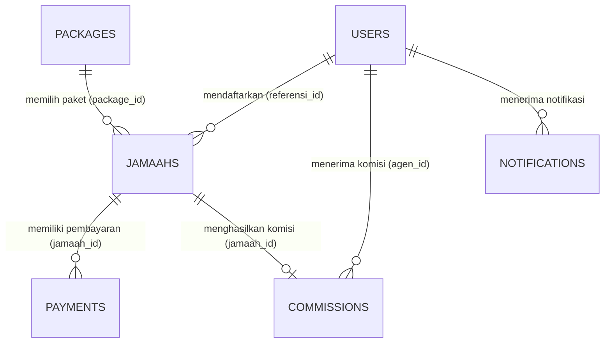

# Dokumentasi & Penjelasan Sistem Web Arbain (Travel Haji & Umroh)

Sistem Informasi Manajemen **Arbain** adalah platform berbasis web terintegrasi yang dirancang khusus untuk mengelola operasional biro perjalanan Umroh dan Haji secara efisien, transparan, dan terstruktur. Platform ini menghubungkan pihak **Manajemen (Administrator)** dengan **Mitra Agen Pemasaran (Agent)** dalam satu sistem terpusat.

---

## 1. Ringkasan Eksekutif (Executive Summary)

Dalam industri perjalanan ibadah Umroh dan Haji, pengelolaan data jamaah, verifikasi berkas paspor/identitas, monitoring angsuran pelunasan, jadwal keberangkatan, serta pembagian komisi mitra agen sering kali menghadapi kendala inkonsistensi manual.

Aplikasi **Arbain** hadir sebagai solusi digital komprehensif yang mencakup:
- **Pendaftaran & Validasi Jamaah**: Pencatatan data jamaah oleh agen dan persetujuan bertingkat oleh admin.
- **Manajemen Transaksi Keuangan**: Pengajuan bukti transfer, pencatatan kas, dan approval pembayaran.
- **Monitoring Kejar Lunas & Kuota**: Peringatan dini jatuh tempo pelunasan (H-60 keberangkatan) dan monitoring kursi paket.
- **Automasi Komisi Kemitraan**: Perhitungan serta penyaluran komisi bagi agen yang jamaahnya telah lunas.
- **Sistem Notifikasi Real-time**: Notifikasi internal setiap kali ada pengajuan jamaah, persetujuan berkas, transaksi baru, maupun pencairan komisi.

---

## 2. Arsitektur Teknologi & Tech Stack

Aplikasi ini dibangun menggunakan arsitektur **Model-View-Controller (MVC)** yang solid, maintainable, dan scalable:

| Layer / Komponen | Teknologi | Keterangan |
|---|---|---|
| **Backend Framework** | **Laravel (PHP 8.x)** | Routing, Controller, Eloquent ORM, Middleware, Notifikasi |
| **Authentication & RBAC** | **Laravel Auth + Spatie Permission** | Multi-role (`Admin` dan `Agen`) dengan proteksi level route |
| **Database** | **MySQL / MariaDB** | Database relasional dengan integritas foreign key & relasi Eloquent |
| **Frontend Templating** | **Blade Template Engine** | Layout modular, component inheritance, dan rendering server-side |
| **CSS & Design System** | **Bootstrap 5 + Custom Modern CSS** | Desain responsif, mobile-friendly, aksen warna brand Arbain (`#DDB02C`) |
| **Typography & Icons** | **Google Fonts (Poppins) + Boxicons + FontAwesome** | Tipografi profesional dan ikon visual modern |
| **Charts & Data Visualization** | **Chart.js 3** | Grafik garis interaktif (tren omset/transaksi) dan donut chart metode bayar |
| **Data Tables** | **jQuery + DataTables (Yajra Datatables)** | Pengurutan, pencarian cepat, paginasi dinamis, dan export data |
| **Reporting & Export** | **Laravel Excel / CSV / PDF** | Unduh laporan keuangan, daftar jamaah, dan invoice resmi |

---

## 3. Desain Basis Data & Struktur Relasi (Database Schema)

Aplikasi memiliki skema database relasional yang terintegrasi penuh:



### Tabel Utama:

1. **`users`**
   - Menyimpan kredensial login (`username`, `email`, `password`), profil (`name`, `phone`, `nik`), serta status akun (`is_active`).
   - Berelasi dengan tabel roles dari Spatie Permission (`Admin` dan `Agen`).

2. **`packages`**
   - Menyimpan daftar paket Umroh/Haji: `name`, `description`, `departure_date`, `price`, dan kuota `total_jamaah`.

3. **`jamaahs`**
   - Menyimpan identitas lengkap jamaah: `nama`, `nik`, `no_paspor`, `tempat_lahir`, `tanggal_lahir`, `jenis_kelamin`, `alamat`, `kontak`, `riwayat_penyakit`.
   - Kolom status: `status` (`pending` / `approved`).
   - Foreign key: `referensi_id` (merujuk ke `users` agen pengaju) dan `package_id` (merujuk ke paket).
   - Finansial: `total_amount` (akumulasi pembayaran yang disetujui).
   - Aksesor dinamis di Model:
     - `tagihan_status`: `'lunas'` jika `total_amount >= package->price`, sebaliknya `'belum lunas'`.
     - `sisa_pembayaran`: Kekurangan pembayaran jamaah.
     - `jatuh_tempo`: 30 hari sebelum tanggal keberangkatan.
     - `scopeBelumLunasDiH60`: Filter jamaah yang belum lunas pada H-60 keberangkatan.

4. **`payments`**
   - Mencatat setiap transaksi pembayaran: `jamaah_id`, `amount`, `payment_method` (`transfer` / `cash`), `payment_proof` (foto bukti transfer), `status` (`pending` / `approved` / `rejected`), dan `processed_by` (admin penilai).

5. **`commissions`**
   - Mencatat komisi mitra agen: `jamaah_id`, `agen_id`, `amount`, dan `status`. Terbit otomatis ketika jamaah binaan agen dinyatakan lunas.

6. **`notifications`**
   - Menyimpan notifikasi in-app untuk pembaruan status pengajuan, pembayaran, dan approval.

---

## 4. Peran Pengguna & Hak Akses (RBAC)

Aplikasi menerapkan pemisahan hak akses ketat menggunakan middleware `auth` dan permission Spatie:

### A. Role: Administrator (`Admin`)
Admin bertindak sebagai penentu kebijakan, pengelola data master, verifikator berkas, dan auditor keuangan.

1. **Dashboard Eksekutif (`/dashboard/admin`)**:
   - Ringkasan KPI: Total Omset (Pemasukan Disetujui), Pertumbuhan Omset Bulan Berjalan, Total Jamaah, Mitra Agen Aktif, dan Total Komisi Tersalurkan.
   - Pusat Antrean & Aksi Cepat: Notifikasi pembayaran pending, pengajuan jamaah baru, peringatan H-60 jatuh tempo, dan paket kursi tersedia.
   - Grafik Interaktif: Switcher tren bulanan (Nominal Omset vs Frekuensi Transaksi) & Donut Chart rasio metode pembayaran (Transfer vs Tunai).
   - Antrean Terkini: Akses satu-klik untuk memvalidasi berkas jamaah dan me-review bukti transfer.
   - Jadwal Keberangkatan Terdekat: Hitung mundur hari keberangkatan (*countdown*) dan keterisian kuota.
   - Leaderboard Agen: Peringkat 5 agen teraktif dengan perolehan jamaah terbanyak.

2. **Persetujuan Pembayaran (`/dashboard/payments/admin`)**:
   - Memvalidasi bukti transfer yang diunggah agen.
   - Aksi: `Setujui (Approve)` atau `Tolak (Reject)`. Jika disetujui, `total_amount` jamaah bertambah secara otomatis dan agen menerima notifikasi.

3. **Persetujuan Jamaah (`/dashboard/jamaah/admin`)**:
   - Memeriksa keabsahan data NIK, paspor, dan data diri jamaah yang diajukan agen.
   - Aksi: `Approve` atau `Reject`.

4. **Manajemen Paket (`/packages`)**:
   - CRUD Paket Umroh/Haji: Nama paket, harga, deskripsi, tanggal keberangkatan, dan kapasitas kuota.

5. **Manajemen Pengguna (`/users`)**:
   - Mengelola akun staf dan mitra agen.
   - Fitur aktivasi & deaktivasi akun agen (`users.activate` / `users.deactivate`).

6. **Daftar Seluruh Jamaah (`/dashboard/listjamaah`)**:
   - Monitoring komprehensif seluruh jamaah, status pelunasan, sisa tagihan, riwayat transaksi individual, dan export data jamaah ke format CSV.

7. **Manajemen Komisi Agen (`/dashboard/commissions`)**:
   - Monitoring hak komisi agen yang dihasilkan dari jamaah lunas.
   - Ekspor data komisi ke Excel untuk keperluan disbursement/pencairan.

8. **Laporan Keuangan (`/laporan-keuangan`)**:
   - Rekapitulasi arus kas masuk, analisis metode pembayaran, serta fitur unduh laporan dalam format CSV/Excel.

---

### B. Role: Mitra Agen (`Agen`)
Agen bertindak sebagai garda depan pemasaran yang merekrut jamaah dan memfasilitasi pembayaran.

1. **Dashboard Agen (`/dashboard/agen`)**:
   - Statistik personal: Jumlah jamaah yang didaftarkan, total komisi yang diperoleh, dan grafik transaksi bulanan binaan agen.

2. **Pengajuan Jamaah Baru (`/dashboard/jamaah/agen`)**:
   - Formulir pendaftaran jamaah: Identitas KTP/NIK, Nomor Paspor, Kontak, Alamat, serta pilihan Paket Perjalanan.
   - Menunggu status verifikasi oleh Admin.

3. **Pengajuan Pembayaran (`/dashboard/payments/agen`)**:
   - Mengajukan bukti setoran atau transfer pembayaran jamaah binaannya.
   - Memilih jamaah, menginput nominal, memilih metode (`transfer` / `cash`), dan mengunggah foto struk/bukti transaksi.

4. **Monitoring Jamaah Saya (`/jamaah-saya`)**:
   - Melihat status terkini jamaah binaannya (Pending, Approved, Belum Lunas, Lunas).
   - Menghasilkan dan mencetak **Invoice / Bukti Pembayaran Resmi** per jamaah (`/jamaah/{id}/invoice`).
   - Ekspor riwayat pembayaran ke format PDF dan Excel.

5. **Komisi Agen (`/dashboard/commissions/agen`)**:
   - Memantau rincian komisi yang telah cair maupun yang sedang dalam proses dari jamaah yang telah lunas.
   - Ekspor data komisi personal ke Excel.

6. **Pengaturan Akun (`/akun-saya`)**:
   - Mengelola profil pribadi, nomor kontak, serta kata sandi akun agen.

---

## 5. Alur Bisnis Utama (Core Workflows)

### Alur 1: Pendaftaran & Verifikasi Jamaah
```
[Agen] Input Form Jamaah -> Database (Status: Pending) -> Notifikasi Masuk ke Admin
                                                                 |
                                                                 v
                                                     [Admin] Periksa Berkas
                                                                 |
                                       +-------------------------+-------------------------+
                                       |                                                   |
                                       v                                                   v
                               [Admin Approve]                                     [Admin Reject]
                        Status: Approved di Sistem                                Pengajuan Ditolak
                        Notifikasi Terkirim ke Agen                              Data Dihapus / Revisi
```

### Alur 2: Transaksi Pembayaran & Pelunasan
```
[Agen / Jamaah] Setor Pembayaran -> [Agen] Upload Bukti & Nominal -> Database (Payment: Pending)
                                                                             |
                                                                             v
                                                                  [Admin] Cek Mutasi Bank
                                                                             |
                                                   +-------------------------+-------------------------+
                                                   |                                                   |
                                                   v                                                   v
                                            [Admin Approve]                                     [Admin Reject]
                                  total_amount Jamaah bertambah                                Pembayaran Batal
                                   Notifikasi Terkirim ke Agen                            Notifikasi Alasan Ditolak
                                                   |
                                                   v
                                      Cek: total_amount >= Harga Paket?
                                                   |
                                      +------------+------------+
                                      | YA                      | TIDAK
                                      v                         v
                               Status: LUNAS             Status: BELUM LUNAS
                         Trigger Komisi Terbit Agen       Masuk Pantauan Cicilan
```

---

## 6. Sistem Notifikasi Otomatis (In-App Notifications)

Aplikasi memiliki 5 kelas notifikasi database otomatis yang berjalan di latar belakang:
1. `NewJamaahAddedNotification`: Memberitahu admin saat ada agen mendaftarkan jamaah baru.
2. `JamaahApprovedNotification`: Memberitahu agen saat jamaah binaannya telah disetujui admin.
3. `PaymentAddedNotification`: Memberitahu admin saat agen mengunggah bukti pembayaran baru.
4. `PaymentApprovedNotification`: Memberitahu agen bahwa pembayaran jamaahnya telah divalidasi.
5. `CommissionAddedNotification`: Memberitahu agen saat komisi hasil pelunasan jamaah telah diterbitkan.

---

## 7. Panduan Konfigurasi & Menjalankan Proyek (Setup Guide)

### Prasyarat:
- PHP >= 8.1
- Composer
- MySQL / MariaDB (XAMPP / Laragon / Standalone)
- Web Browser modern (Chrome, Edge, Firefox)

### Langkah Instalasi:

1. **Clone / Buka Proyek**:
   ```bash
   cd c:\Users\rizky\Downloads\arbain-main
   ```

2. **Install Dependensi Composer**:
   ```bash
   composer install
   ```

3. **Konfigurasi Environment (`.env`)**:
   Salin `.env.example` ke `.env` dan sesuaikan koneksi database MySQL:
   ```env
   APP_NAME="Arbain"
   APP_ENV=local
   APP_KEY=base64:...
   APP_DEBUG=true
   APP_URL=http://127.0.0.1:8000

   DB_CONNECTION=mysql
   DB_HOST=127.0.0.1
   DB_PORT=3306
   DB_DATABASE=arbain
   DB_USERNAME=root
   DB_PASSWORD=
   ```

4. **Generate Application Key**:
   ```bash
   php artisan key:generate
   ```

5. **Migrasi Database & Seeder**:
   Buat database `arbain` di MySQL, lalu jalankan:
   ```bash
   php artisan migrate
   php artisan db:seed
   ```

6. **Hubungkan Symlink Storage**:
   ```bash
   php artisan storage:link
   ```

7. **Jalankan Server Lokal**:
   ```bash
   php artisan serve --port=8000
   ```
   Aplikasi dapat diakses di: **`http://127.0.0.1:8000`**

---

## 8. Kredensial Akun Bawaan (Default Accounts)

Database Seeder telah menyediakan akun siap pakai untuk kebutuhan demonstrasi dan pengujian:

| Role | Username | Password | Email | Halaman Dashboard |
|---|---|---|---|---|
| **Administrator** | `adminuser` | `123456789` | `admin@example.com` | `http://127.0.0.1:8000/dashboard/admin` |
| **Mitra Agen** | `agenuser` | `123456789` | `agen@example.com` | `http://127.0.0.1:8000/dashboard/agen` |

---

## 9. Struktur Folder Proyek

```
arbain-main/
├── app/
│   ├── Http/
│   │   ├── Controllers/
│   │   │   ├── Admin/
│   │   │   │   └── AdminDashboardController.php  <-- Controller Utama Dashboard Eksekutif
│   │   │   ├── Agent/
│   │   │   │   └── AgentDashboardController.php  <-- Controller Dashboard Agen
│   │   │   ├── AdminJamaahController.php         <-- Approval Jamaah
│   │   │   ├── AdminPaymentController.php        <-- Approval Pembayaran
│   │   │   ├── AuthController.php                <-- Autentikasi & Multi-role Redirect
│   │   │   ├── CommissionController.php          <-- Manajemen Komisi
│   │   │   ├── HistoryPaymentController.php      <-- Riwayat & Export Invoice Jamaah
│   │   │   ├── JamaahController.php              <-- Input Jamaah Agen
│   │   │   ├── ListJamaahController.php          <-- Daftar Lengkap Jamaah
│   │   │   ├── PackageController.php             <-- CRUD Paket Umroh/Haji
│   │   │   ├── PaymentController.php             <-- Upload Pembayaran
│   │   │   └── UserController.php                <-- Manajemen User Agen/Admin
│   ├── Models/
│   │   ├── Commission.php                        <-- Model Komisi
│   │   ├── Jamaah.php                            <-- Model Jamaah & Logika Pelunasan
│   │   ├── Package.php                           <-- Model Paket Perjalanan
│   │   ├── Payment.php                           <-- Model Transaksi Pembayaran
│   │   └── User.php                              <-- Model Pengguna & Role
│   └── Notifications/                            <-- 5 Notifikasi Real-time
├── database/
│   ├── migrations/                               <-- 17 File Skema Database
│   └── seeders/                                  <-- Database & Account Seeder
├── public/
│   ├── css/                                      <-- Bootstrap & Style Arbain
│   ├── js/                                       <-- Script Helper & Chart Helpers
│   └── img/                                      <-- Logo & Wallpaper Login
├── resources/
│   └── views/
│       ├── auth/                                 <-- Halaman Login
│       ├── dashboard/
│       │   ├── admin/
│       │   │   └── index.blade.php               <-- Tampilan Dashboard Admin Modern
│       │   ├── agen/                             <-- Tampilan Dashboard Agen
│       │   └── layouts/
│       │       ├── main.blade.php                <-- Master Layout
│       │       └── side.blade.php                <-- Sidebar Navigasi Dinamis
│       └── laporan-keuangan/                     <-- View Laporan Keuangan
└── routes/
    └── web.php                                   <-- Definisi Routing & Middleware
```

---

## 10. Kesimpulan

Aplikasi **Arbain** merupakan sistem enterprise-ready untuk biro travel ibadah yang mengedepankan keamanan data, kejelasan arus kas masuk, pengawasan jatuh tempo pelunasan, serta transparansi bagi hasil dengan mitra agen. Melalui antarmuka yang bersih, grafik analitik terpadu, dan otomasi alur verifikasi, platform ini meningkatkan efisiensi operasional travel secara signifikan.
